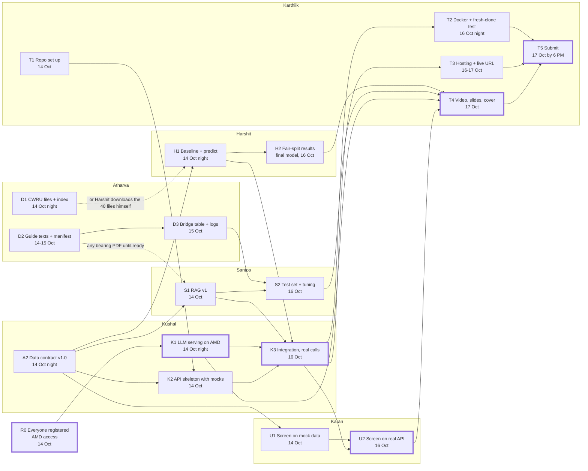

# Dependency Graph: AMD Hackathon ACT III (Track 1, CWRU bearing assistant)

Who is waiting on whom. Read this when you are blocked, or before you start, to see whose work you need and who needs yours.

- Solid arrow: B cannot be finished until A is done.
- Dashed arrow: B can start without A, using a stand-in (a mock file, any PDF, or a direct download).
- Thick-bordered boxes are the critical path. If one of these slips, the submission slips.

**Deadline:** submissions close on **17 Oct, 10:30 PM**. We plan as if that is India time (confirm the zone on Discord). Features freeze at the end of **16 Oct**, and we aim to submit by **6 PM on 17 Oct**, leaving a buffer.

## The graph

If the graph does not render, use the table below. GitHub shows it automatically.

## The same thing as a table

| ID | Deliverable | Owner | Needs | Unblocks | Due |
| --- | --- | --- | --- | --- | --- |
| R0 | Everyone registered (lablab.ai, Discord, AMD AI Developer Program) and AMD access | All | Nothing | K1 | 14 Oct |
| T1 | Repo set up: licence, ignore file, env example, templates, branch protection | Karthiik, with Kushal | Repo link from Kushal | K2, and everyone's pull requests | 14 Oct |
| A2 | Data contract v1.0 | Kushal | Nothing | K2, H1, S1, U1 | 14 Oct night |
| K1 | LLM serving on AMD (Token Factory or own vLLM) | Kushal | R0 | K3, T4 (AMD proof) | 14 Oct night |
| K2 | API skeleton returning mock data | Kushal | A2, T1 | K3 | 14 Oct |
| D1 | CWRU download script and index (40 files) | Atharva | Nothing | H1 (soft) | 14 Oct night |
| D2 | Cleaned guide texts and manifest | Atharva | Nothing | D3, S1 (soft) | First two 14 Oct night, all by 15 Oct midday |
| D3 | Bridge table and synthetic logs | Atharva | D2 | S2 | 15 Oct |
| H1 | Baseline classifier and `predict` | Harshit | A2, D1 (soft) | H2, K3 | 14 Oct night |
| H2 | Fair-split results and final model | Harshit | H1 | K3 (final model), T4 | 16 Oct |
| S1 | RAG first version | Santos | A2, D2 (soft) | S2, K3 | 14 Oct |
| S2 | Test set, hit rate, tuned retrieval | Santos | S1, D3 | T4 | 16 Oct |
| K3 | Integration with real calls | Kushal | H1, S1, K1, K2 | U2, T2, T3, T4 | 16 Oct |
| U1 | Screen on mock data | Karan | A2 (sample JSON) | U2 | 14 Oct |
| U2 | Screen connected to the real API | Karan | U1, K3 | T4 | 16 Oct |
| T2 | Docker build and fresh-clone test | Karthiik | K3 | T5 | 16 Oct night |
| T3 | Hosting and live URL | Karthiik, with Kushal | K3, hosting decision on 15 Oct | T5 | 16 to 17 Oct |
| T4 | Demo video, slides, cover image | Karthiik | U2, H2, S2, K1 | T5 | 17 Oct |
| T5 | Submit | Karthiik | T2, T3, T4 | Nothing | 17 Oct by 6 PM |

"Soft" means a stand-in exists, so the person is not truly blocked.

## Critical path

R0, then K1, then K3, then U2, then T4, then T5.

H1 and S1 feed into K3 at the same time as K1, so a late classifier or a late search delays integration just like a late AMD server does. Watch all four every night.

## Who can be truly blocked, and what to do

| Person | Waiting on | What to do instead of waiting |
| --- | --- | --- |
| Harshit | Atharva's CWRU files | Download the 40 files from the table in your brief and start. Atharva's script replaces this later |
| Santos | Atharva's guide texts | Test on any bearing PDF you already have |
| Karan | Kushal's API | Build on the sample JSON in your brief. Switch to the real API after 15 Oct |
| Kushal | The classifier and the search | Use mock results in the contract shape until the real functions arrive |
| Karthiik | Everyone's numbers | Prepare the storyboard, slide outline, README skeleton and repo setup first. Fill in numbers last |

## Keeping this file honest

- Kushal owns this file. Update it at the nightly check-in when a date moves or a dependency changes.
- If you are blocked for more than an hour, say so in the team chat and name the node, for example "blocked on K3".
- If the data contract changes (A2), everyone downstream of A2 is affected, so announce it in the team chat before merging.
